# 🤖 Codebase Personality Profiler

> An AI-powered repository intelligence platform that ingests any public GitHub repository, computes deep behavioral and engineering health metrics, and generates an evidence-based "personality" profile — complete with codebase archetypes, trait scores, contributor intelligence, interactive visualizations, and embeddable SVG badges.


---

## 📖 About the Project

Every codebase tells a story through its commit history, pull request velocity, file churn, and contributor dynamics. **Codebase Personality Profiler** transforms raw GitHub metadata into both **actionable engineering insights** and **witty, evidence-backed personality assessments**.

Whether you want to evaluate the bus factor of an open-source dependency, inspect file churn hotspots before refactoring, understand individual contributor work styles, or simply roast your team's late-night commit habits, this tool synthesizes hundreds of data points into a cohesive interactive dashboard.

### Why It Stands Out
- **Zero-Config Fallback Mode** — Works out of the box without API keys using a deterministic rule-based personality and README-parsing engine, while seamlessly upgrading to `gpt-4o-mini` when an OpenAI key is configured.
- **Bring Your Own Keys (BYOK)** — Users can supply personal GitHub tokens (`5,000 req/hr`) and OpenAI API keys directly in the browser UI via the Settings modal (`x-github-token` and `x-openai-key` headers) without modifying server environment variables.
- **Smart 1-Hour SQLite Caching** — Repeated analyses of the same repository within an hour are served instantaneously from the local SQLite database via Prisma 7, avoiding redundant GitHub API calls and LLM token usage.
- **Graceful Degradation** — If SQLite persistence is unavailable (e.g., read-only serverless environments), the pipeline still completes and returns a full in-memory report.

---

## ✨ Key Features & Dashboard Views

The application provides **7 specialized dashboard tabs** alongside shareable public reports:

1. **Overview** — High-level repository synthesis, project goals, extracted key features, primary use cases, language distribution bars, detected tech stack badges, and top contributor cards.
2. **Contributors Intelligence** — Individual contributor profiles featuring custom archetypes, commit counts, net lines changed, average/largest commit sizes, active & longest streaks, PR merge velocity, activity heatmaps, and a force/network **Collaboration Graph** mapping co-authored file overlaps.
3. **Code Health & Risk** — A composite **Risk Score (0–100)** with plain-English risk diagnostics, an interactive **File Churn Treemap** highlighting the top 15 most frequently modified hotspot files, and a `package.json` dependency staleness auditor.
4. **Humorous Traits** — Evidence-backed trait meters (e.g., *Developer Anxiety*, *Test Phobia*, *Lone Wolf Syndrome*) paired with a multi-axis **Trait Radar Chart**.
5. **Metrics Dashboard** — Granular ECharts visualizations for commit frequency per day/week, time-of-day distribution (Morning, Afternoon, Evening, Night), and keyword-based commit classification ratios (Fix, Feature, Refactor, Test).
6. **Compare Repos** — Side-by-side comparative analysis of two GitHub repositories across health scores, bus factor, commit ratios, and personality archetypes.
7. **Predictions & Roasts** — AI-generated (or deterministic) forecasts about the repository's future technical debt and team dynamics.
8. **Shareable Reports & README Badges** — Permanent read-only permalinks (`/report/:id`), downloadable social summary cards (`html2canvas`), and dynamic SVG status badges (`/api/badge/:owner/:repo`) ready to embed in any `README.md`.

---

## 🏗️ Architecture



### 🔄 Analysis & Profiling Pipeline



### 📂 Directory Structure

```text
├── app/
│   ├── page.tsx                           # Next.js root entry & dashboard view
│   ├── layout.tsx                         # Root HTML layout, fonts & metadata
│   ├── report/[id]/page.tsx               # Public read-only permalink report page
│   └── api/
│       ├── analyze/route.ts               # POST — orchestrates GitHub fetch, metrics, OpenAI & DB upsert
│       ├── report/route.ts                # GET  — retrieves a stored report by ID from SQLite
│       ├── status/route.ts                # GET  — reports server-side GitHub/OpenAI key configuration
│       └── badge/[owner]/[repo]/route.ts  # GET  — renders dynamic SVG archetype badge
├── frontend/
│   ├── index.html                         # Vite entry point
│   └── src/
│       ├── components/
│       │   ├── charts/                    # AreaChartCard, BarChartCard, PieChartCard, TraitRadarChart
│       │   ├── dashboard/                 # DashboardView + 7 specialized tab components
│       │   ├── home/                      # SearchHero, ScanningConsole, ErrorPanel
│       │   ├── layout/                    # AppHeader, AppFooter, AppBackground
│       │   ├── CollaborationGraph.vue     # SVG contributor file-overlap network graph
│       │   ├── Heatmap.vue                # Commit calendar activity heatmap
│       │   ├── SettingsModal.vue          # Browser BYOK credential configuration modal
│       │   ├── ShareCard.vue              # Exportable social card & badge snippet generator
│       │   └── Treemap.vue                # File churn hotspot treemap visualization
│       ├── composables/                   # useAnalysis & useCredentials reactive state hooks
│       └── router/                        # Vue Router views (HomeView, ReportView)
├── lib/
│   ├── github.ts                          # GitHub REST API client (meta, commits, PRs, stats, README)
│   ├── metrics.ts                         # Repository-wide commit frequency, ratios, bus factor & collab index
│   ├── contributors.ts                    # Per-contributor aggregation, streaks, heatmaps & overlap graph
│   ├── repoHealth.ts                      # File churn hotspots, language breakdown, dep audit & risk score
│   ├── prompt.ts                          # Structured prompt builders for repo & contributor LLM calls
│   ├── openai.ts                          # OpenAI API client (gpt-4o-mini) + deterministic mock engine
│   └── prisma.ts                          # Prisma 7 singleton with better-sqlite3 driver adapter
└── prisma/
    └── schema.prisma                      # SQLite database schema
```

---

## 🔌 API Endpoints

| Method | Endpoint | Description |
|---|---|---|
| `POST` | `/api/analyze` | Accepts `{ "repo": "owner/name" }` or `{ "url": "https://github.com/..." }`. Supports optional `x-github-token` and `x-openai-key` headers. Returns full analysis payload (cached if `< 1 hr` old). |
| `GET` | `/api/report?id=<id>` | Fetches a previously persisted repository report, including contributor metrics and profiles, by database ID. |
| `GET` | `/api/status` | Returns `{ githubConfigured: boolean, openaiConfigured: boolean }` indicating whether server `.env` keys are active. |
| `GET` | `/api/badge/[owner]/[repo]` | Generates an embeddable, cache-controlled SVG badge displaying the repository's assigned personality archetype. |

---

## 📊 Metrics & Risk Scoring Engine

### Repository Metrics (`lib/metrics.ts`)

| Metric | How It Is Computed |
|---|---|
| **Fix Ratio** | Percentage of commit messages matching `fix`, `bug`, `hotfix`, `patch`, `resolve`, or `error` |
| **Feature Ratio** | Percentage of commit messages matching `feat`, `feature`, `add`, `implement`, or `new` |
| **Refactor Ratio** | Percentage of commit messages matching `refactor`, `cleanup`, `restructure`, `reorganize`, or `optimize` |
| **Test Ratio** | Percentage of commit messages matching `test`, `spec`, `testing`, `jest`, `cypress`, or `mock` |
| **Bus Factor** | Minimum number of contributors whose combined commits account for **≥ 50%** of total repository commits |
| **Collaboration Index** | Average number of distinct authors who have modified each tracked file across the commit history |
| **Time-of-Day Split** | UTC commit timestamp distribution across Morning (`06–12`), Afternoon (`12–18`), Evening (`18–24`), and Night (`00–06`) |

### Code Health & Risk Score (`lib/repoHealth.ts`)

Every repository starts at a baseline risk score of **20 / 100** and accumulates risk penalties up to **100**:
- **Critical Bus Factor (`+30`)** — A single developer authors `> 50%` of all commits (`+15` if Bus Factor is `2`).
- **Extreme Test Phobia (`+25`)** — Fewer than `2%` of commits mention tests or specs (`+10` if `< 7%`).
- **High Code Churn (`+15`)** — `5` or more hotspot files have been modified `≥ 8` times in recent history.
- **High Bug-Fix Anxiety (`+15`)** — Over `45%` of all commits are bug fixes or patches.

---

## 🎭 Personality Archetypes (Deterministic Fallback Engine)

When no OpenAI API key is provided, `lib/openai.ts` uses a deterministic rule engine to assign archetypes:

### Repository Archetypes

| Archetype | Trigger Condition | Profile Summary |
|---|---|---|
| **The Nocturnal Firefighter** | `Fix Ratio > 50%` | Dominated by hotfixes and emergency patches; high developer anxiety. |
| **The Quality Assurance Bureaucrat** | `Test Ratio > 25%` | Spec-driven and heavily guarded; slow, surgical, and bulletproof progress. |
| **The Solo Crusader** | `Bus Factor === 1` | A one-person empire filled with bespoke abstractions owned by a single mind. |
| **The Chaotic Startup** | Default / Mixed signals | High-velocity feature shipping where tests are treated as an optional luxury. |

### Contributor Archetypes

| Archetype | Trigger Condition |
|---|---|
| **The Drive-By Committer** | `≤ 3` total commits |
| **The Nocturnal Firefighter** | Contributor `Fix Ratio > 40%` |
| **The Quality Assurance Disciple** | Contributor `Test Ratio > 15%` |
| **The One-Line Bloater** | Average commit size `> 400` lines changed |
| **The Silent Git Anarchist** | `> 5` commits pushed directly with `0` pull requests opened |
| **The Consistent Builder** | Balanced commit cadence and size across the repository |

---

## 🗃️ Database Schema (ERD)

The application persists reports in **SQLite** (`dev.db`) using [Prisma 7](https://www.prisma.io/) and `@prisma/adapter-better-sqlite3`.

- **`Repository`** — Aggregate root storing repository metadata (`owner`, `name`, `url`), JSON snapshots (`profileJson`, `metricsJson`, `healthJson`), and actionable extension fields.
- **`Metric`** — Historical numeric metric records linked `N:1` to `Repository`.
- **`Contributor`** — Unique `(repositoryId, username)` records for each repository author.
- **`ContributorMetric`** — `1:1` JSON store of granular contributor stats (streaks, heatmaps, PR merge times, language counts).
- **`ContributorProfile`** — `1:1` AI/mock personality profile (`archetype`, `summary`, `traitsJson`, `superlativesJson`, `funFact`).



---

## 🚀 Getting Started

### Prerequisites

- **Node.js 18+** and `npm`
- **GitHub Personal Access Token** *(optional — raises GitHub rate limit from 60 to 5,000 requests/hour)*
- **OpenAI API Key** *(optional — enables live `gpt-4o-mini` profiling; falls back to the mock engine if omitted)*

### 1. Clone & Install Backend Dependencies

```bash
git clone https://github.com/mennatallahessam/codebase-profile-builder.git
cd "codebase personality profile"

# Install root dependencies & generate Prisma client
npm install
npx prisma generate
npx prisma db push
```

### 2. Configure Environment Variables

Create or edit `.env` in the project root:

```env
DATABASE_URL=file:./dev.db
GITHUB_TOKEN=your_github_personal_access_token
OPENAI_API_KEY=your_openai_api_key
NEXT_PUBLIC_BASE_URL=http://localhost:3000
```

> **Tip:** You can leave `GITHUB_TOKEN` and `OPENAI_API_KEY` blank in `.env` and either use the built-in mock engine or enter keys at runtime via the **Settings** button in the web UI.

### 3. Run the Application

**Start the Next.js API & server (`http://localhost:3000`):**

```bash
npm run dev
```

**Start the Vue 3 + Vite frontend (`frontend/`):**

```bash
cd frontend
npm install
npm run dev
```

---

## 📦 Tech Stack

| Layer | Technology | Purpose |
|---|---|---|
| **Backend / API** | Next.js 16 (App Router) | REST API endpoints, caching orchestration, SVG badge rendering |
| **Frontend SPA** | Vue 3.5 + Vite 6 + Vue Router 4 | Interactive multi-tab analytics dashboard & client routing |
| **Styling** | Tailwind CSS 4 | Glassmorphic dark UI, responsive grid layouts, custom animations |
| **Visualizations** | Apache ECharts (`vue-echarts`) + Custom SVG | Radar charts, area/bar/pie charts, heatmaps, treemaps, network graphs |
| **Database & ORM** | SQLite 3 + Prisma 7 (`better-sqlite3`) | Local relational persistence and 1-hour report caching |
| **AI Integration** | OpenAI SDK (`gpt-4o-mini`) | Evidence-based repository & contributor personality synthesis |
| **HTTP & Validation** | Axios + Zod | GitHub REST API pagination/fetching and schema validation |

---

## 📄 License

MIT — built by Mennatallah Essam as a personal project.
